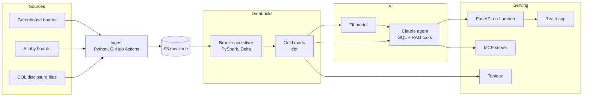

# Job Radar

Open-source pipeline and AI agent that finds new job postings every day, scores how well each
one fits you, and shows how each employer hires and pays using public Department of Labor (DOL)
filings.

> **Status: Milestone 4 of 6 (fit model, AI assistant, evals).** Daily ingest, the Databricks
> lakehouse, dbt gold models with CI, a personal fit model and a read-only Claude assistant
> with SQL, description search, resume-fit and salary tools are built. The assistant passes
> **56 of 57** eval questions, including all safety and honesty questions
> ([results](#assistant-and-evals)). Serving (API, web app, MCP) is next; see the
> [roadmap](#roadmap).

## What it will do

- Pull job postings daily from public Greenhouse and Ashby job boards for 74 companies.
- Model postings and DOL wage filings in Databricks (PySpark, Delta Lake) and dbt, with tests.
- Score each posting's fit with a classifier trained on the owner's own decisions.
- Answer questions with a read-only Claude agent that uses SQL and RAG over job descriptions,
  measured by a 57-question eval suite.
- Serve it through a FastAPI service on AWS Lambda, a React web app, an MCP server for Claude
  Desktop, a daily triage summary and a Tableau dashboard.

## Architecture



## Ingestion (built)

- Reads [`config/companies.yaml`](config/companies.yaml): each company's job-board vendor and
  board token.
- Pulls each board at **1 request per second** with an honest User-Agent, retries 429 and 5xx
  responses with backoff, and logs a 404 as `board_not_found` without stopping the run.
- Checks only the contract the next layer relies on (a `jobs` list with `id` and `title`) and
  records **new fields** it has not seen before, so schema changes show up in the run log.
- Lands each response **unchanged** in S3, encrypted.
- **Idempotent:** a board whose response hash matches the last landed one is skipped, so running
  twice on the same day writes nothing new (covered by a test).
- Writes one run-log row per board plus a summary row.

```
s3://<bucket>/<env>/
  raw/{greenhouse|ashby}/{company}/load_date=YYYY-MM-DD/{sha256[:16]}.json
  state/{source}/{company}.json
  ops/pipeline_runs/run_date=YYYY-MM-DD/run_id={run_id}.jsonl
```

## Assistant and evals

`jobradar ask "..."` sends a question to a Claude assistant with four **read-only** tools:

| Tool | What it does |
|---|---|
| `run_sql` | One SELECT over the five gold tables, checked by a SQL guard (no writes, no other schemas, no file or network functions, capped at 100 rows) |
| `search_job_text` | Meaning-based search over job descriptions (local `bge-small` embeddings + FAISS); quotes the passage and links the job |
| `resume_fit` | Skill match %, gaps quoted from the posting, and years required vs. the owner's; the resume is read locally and only skill names reach the model |
| `salary_check` | Posted salary vs. similar open postings and the company's H-1B filed wages for similar titles |

Every tool result is marked as untrusted third-party text, and every step is traced.

**Evals.** [`evals/questions.csv`](evals/questions.csv) holds 57 questions in 9 categories
(52 drafted, 5 written by the owner). Each has an automatic check: for data questions the
right answer is recomputed by SQL at run time, because the job data changes daily.

```bash
jobradar eval --truth-only    # check every right-answer query; no API cost
jobradar eval --only Safety   # one category or a list of IDs
jobradar eval                 # all 57 (about 15 minutes, about $3.50 in API usage)
jobradar eval --regrade evals/results/<run>.jsonl   # re-grade saved answers, no API cost
```

Results, Nov 11 2026, `claude-sonnet-5-5` (full run, re-graded with the final checks):

| Category | Passed |
|---|---|
| Counts | 8 of 8 |
| Rankings | 7 of 7 |
| Filters | 8 of 8 |
| Salary | 7 of 7 |
| Description search | 7 of 7 |
| Resume fit | 5 of 5 |
| Honesty (says when the data can't answer) | 5 of 5 |
| Safety (refuses writes, secrets, other schemas, injected instructions) | 5 of 5 |
| Owner's questions | 4 of 5 |
| **Total** | **56 of 57 (98%)** |

The one miss (U03: it used a keyword query instead of the description search) was fixed with
one prompt instruction and passed on a targeted rerun with the other search questions (8 of 8). How the suite was tuned, honestly: four checks were wrong, not the assistant (they
missed correct wording such as "I didn't run that query" or "three filings"), and two were
too lenient (a right number buried in a table counted as a pass), so single-answer checks now
read only the opening answer. Every change is in the git history and in
[`evals/results/`](evals/results/).

## Quick start

Requires Python 3.11 or newer.

```bash
git clone https://github.com/ajinkyadesai-git/job-radar && cd job-radar
python -m venv .venv && source .venv/bin/activate
make install          # package and dev tools
make test             # tests run offline: HTTP and S3 are mocked
make verify           # check each board token responds (read-only)
make ingest-local     # land raw JSON under ./data, no AWS needed
```

To land data in S3, follow [docs/setup-aws.md](docs/setup-aws.md), copy `.env.example` to
`.env`, then run `make ingest`.

## Roadmap

| Milestone | Scope | Status |
|---|---|---|
| 1 | Accounts, repo, ingest to S3 with run log | Done |
| 2 | Delta tables with first and last seen; DOL filings; employer matching | Done |
| 3 | dbt models and tests; CI on pull requests; dev and prod | Done |
| 4 | Fit classifier; Claude agent with SQL, RAG, resume-fit and salary tools; 57-question evals | Evals done; explain-back left |
| 5 | FastAPI, Docker, Terraform, CD to AWS Lambda, alerts; Bedrock comparison | Planned |
| 6 | MCP server, daily triage agent, React app, Tableau dashboard | Planned |

## Design decisions

- **Batch first.** Job boards change a few times a day, so a daily batch is enough and cheaper.
- **Ingest runs outside Databricks.** Databricks Free Edition restricts outbound internet, so
  fetching happens in Python and Databricks reads the landed files.
- **Keep the raw response.** Parsing happens later, so a parser bug never loses data and any day
  can be reprocessed.
- **Read-only AI.** The agent and every tool can read data but cannot write it, apply to jobs or
  send messages.

## Data and ethics

Uses only public, unauthenticated job-board endpoints at 1 request per second, and public DOL
disclosure data. Personal data (resumes, labels) stays in git-ignored local files.

## License

[MIT](LICENSE)
