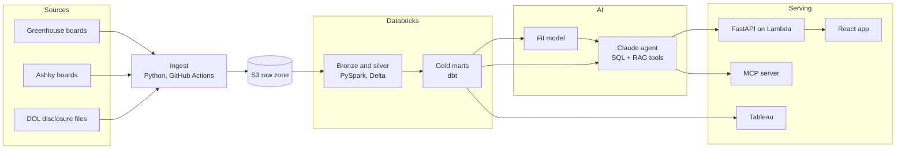

# Job Radar

Open-source pipeline and AI agent that finds new job postings every day, scores how well each
one fits you, and shows how each employer hires and pays using public Department of Labor (DOL)
filings.

> **Status: Milestone 1 of 6 (foundations and ingest).** Daily ingestion from Greenhouse and
> Ashby job boards into S3 is built and tested with mocked APIs. Everything below the ingest
> layer is planned; see the [roadmap](#roadmap).

## What it will do

- Pull job postings daily from public Greenhouse and Ashby job boards for 20 to 30 companies.
- Model postings and DOL wage filings in Databricks (PySpark, Delta Lake) and dbt, with tests.
- Score each posting's fit with a classifier trained on the owner's own decisions.
- Answer questions with a read-only Claude agent that uses SQL and RAG over job descriptions,
  measured by a 40-question eval suite.
- Serve it through a FastAPI service on AWS Lambda, a React web app, an MCP server for Claude
  Desktop, a daily triage summary and a Tableau dashboard.

## Architecture



## Ingestion (built)

- Reads [`config/companies.yaml`](config/companies.yaml): each company's job-board vendor and
  board token.
- Pulls each board at **1 request per second** with an honest User-Agent, retries 429 and 5xx
  responses with backoff, and logs a 404 as `board_not_found` without stopping the run.
- Checks only the contract the next layer relies on (a `jobs` list with `id` and `title`) and
  records **new fields** it has not seen before, so schema changes show up in the run log.
- Lands each response **unchanged** in S3, encrypted.
- **Idempotent:** a board whose response hash matches the last landed one is skipped, so running
  twice on the same day writes nothing new (covered by a test).
- Writes one run-log row per board plus a summary row.

```
s3://<bucket>/<env>/
  raw/{greenhouse|ashby}/{company}/load_date=YYYY-MM-DD/{sha256[:16]}.json
  state/{source}/{company}.json
  ops/pipeline_runs/run_date=YYYY-MM-DD/run_id={run_id}.jsonl
```

## Quick start

Requires Python 3.11 or newer.

```bash
git clone https://github.com/ajinkyadesai-git/job-radar && cd job-radar
python -m venv .venv && source .venv/bin/activate
make install          # package and dev tools
make test             # tests run offline: HTTP and S3 are mocked
make verify           # check each board token responds (read-only)
make ingest-local     # land raw JSON under ./data, no AWS needed
```

To land data in S3, follow [docs/setup-aws.md](docs/setup-aws.md), copy `.env.example` to
`.env`, then run `make ingest`.

## Roadmap

| Milestone | Scope | Status |
|---|---|---|
| 1 | Accounts, repo, ingest to S3 with run log | In progress |
| 2 | Delta tables with first and last seen; DOL filings; employer matching | Planned |
| 3 | dbt models and tests; CI on pull requests; dev and prod | Planned |
| 4 | Fit classifier; Claude agent with SQL and RAG; 40-question evals | Planned |
| 5 | FastAPI, Docker, Terraform, CD to AWS Lambda, alerts; Bedrock comparison | Planned |
| 6 | MCP server, daily triage agent, React app, Tableau dashboard | Planned |

## Design decisions

- **Batch first.** Job boards change a few times a day, so a daily batch is enough and cheaper.
- **Ingest runs outside Databricks.** Databricks Free Edition restricts outbound internet, so
  fetching happens in Python and Databricks reads the landed files.
- **Keep the raw response.** Parsing happens later, so a parser bug never loses data and any day
  can be reprocessed.
- **Read-only AI.** The agent and every tool can read data but cannot write it, apply to jobs or
  send messages.

## Data and ethics

Uses only public, unauthenticated job-board endpoints at 1 request per second, and public DOL
disclosure data. Personal data (resumes, labels) stays in git-ignored local files.

## License

[MIT](LICENSE)
