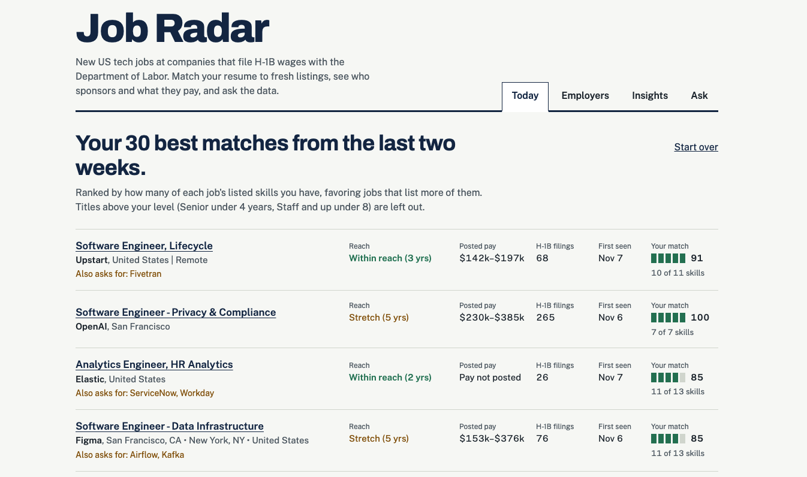
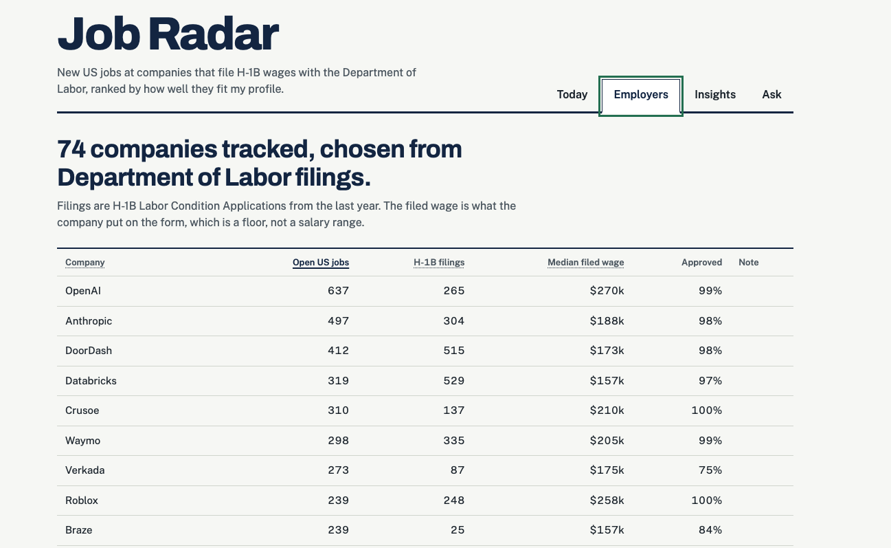
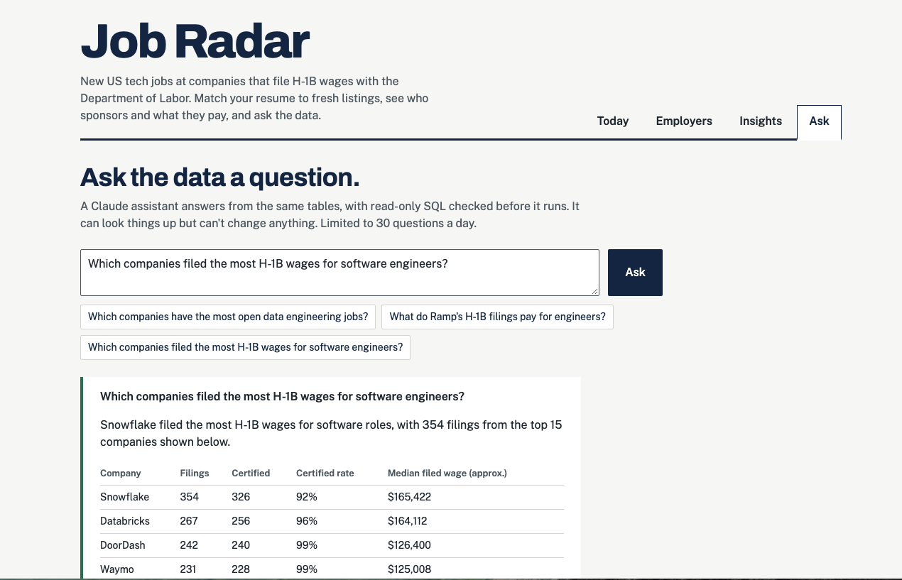
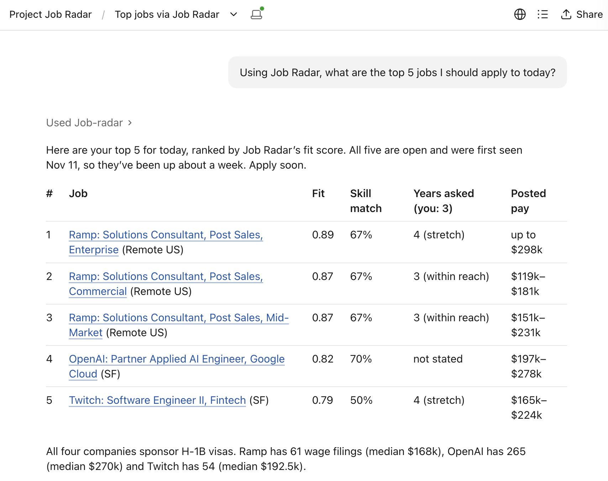
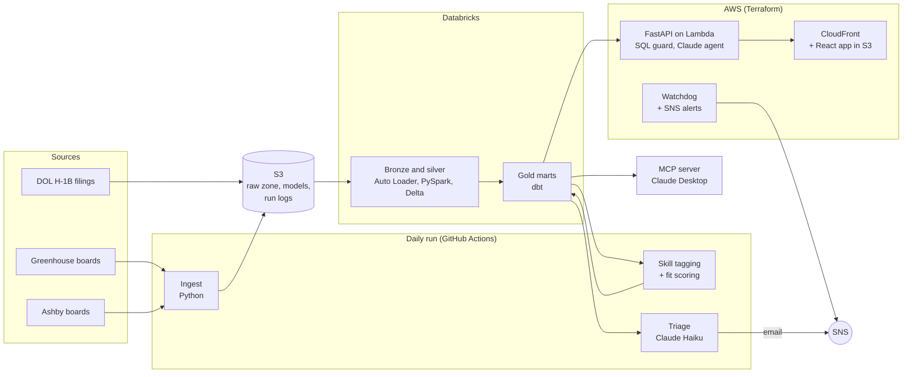

# Job Radar

**New US tech jobs at companies that actually sponsor H-1B visas, matched to your resume, refreshed every morning.**

**[Live demo → ajinkyadesai-git.github.io/job-radar](https://ajinkyadesai-git.github.io/job-radar)**

Job seekers on visas lose hours checking career pages and guessing which employers will sponsor.
Job Radar collects about 15,000 open jobs a day from 74 companies, checks each employer against
554,000 public Department of Labor (DOL) H-1B wage filings, drops postings that say they won't
sponsor, and ranks what's left. Upload a resume and it shows the freshest jobs that fit your
skills, with what's missing and whether the experience asked for is within reach. Your resume is
read in your browser and never uploaded.



| | |
|---|---|
| Open jobs tracked daily | about 15,000 from 74 companies (Greenhouse and Ashby public boards) |
| DOL filings linked | 554,190 cases; 96% of open jobs matched to their employer's filings |
| Data tests | 64 dbt models and tests on every build; a failing test blocks the merge |
| AI evals | 56 of 57 on Sonnet; Haiku 40 of 40 on the categories the public site uses; 100% safety and honesty |
| Code tests | 235 Python tests and 8 web tests, run in CI on every PR |
| Running cost | free tiers; AI spend capped (public Ask 30 questions a day, triage $0.05 a day) |

## What you can do on the site

- **Match my resume.** Drop in a PDF, Word or text resume. The page finds your skills, lets you
  fix them, and ranks jobs from the last two weeks by the share of each job's skills you have,
  with missing skills and reach for your years of experience.
- **Employers.** All 74 companies with their H-1B record: filings, approval rate, median filed
  wage, and whether they're H-1B dependent.
- **Insights.** New jobs per day, the most-asked skills, pay by role family, and top sponsors.
- **Ask.** Plain-English questions to a Claude assistant that answers from the data, with a
  daily cap.

| | |
|---|---|
|  |  |
|  |  |

For me, the owner, the same site has a private view: my own ranked list, scored by a model
trained on 200 jobs I labeled, behind a passphrase the API checks. A daily email picks the jobs
I should apply to, and the tools also work inside Claude Desktop through MCP.

## Architecture



**Daily flow.** At about 6 am Pacific, GitHub Actions pulls every board into S3 (idempotent, one
request a second), starts the Databricks job that loads bronze and merges silver (first seen,
last seen, closed), rebuilds and tests the dbt gold models, tags each open job with its skills,
scores fit with a published model, rebuilds the postings table, and emails a triage digest. A
watchdog on Lambda emails me if the run is late, failed or stale.

## How it's built

### Data pipeline

- **Ingest** ([`src/jobradar/ingest`](src/jobradar)): Greenhouse and Ashby public APIs at 1
  request per second with retries and backoff. Raw JSON lands unchanged in an encrypted,
  versioned S3 bucket. A response whose hash matches the last one is skipped, so a second run on
  the same day writes nothing.
- **Lakehouse** ([`spark/`](spark/)): Databricks reads S3 through a read-only external location;
  **Auto Loader** loads each new file once into bronze; a **Delta MERGE** keeps one silver row
  per posting with first seen, last seen and closed dates.
- **DOL filings**: four quarters of LCA disclosure data, wages converted to yearly, personal
  columns dropped before upload. Employers are matched by name normalization plus a
  hand-checked alias table (96% of open jobs).
- **dbt** ([`dbt/`](dbt/)): staging views and gold tables (`fct_postings`, `dim_employer`,
  `fct_lca`, `mart_new_postings`, `mart_sponsor_stats`). Business rules (US only, role family,
  seniority, visa blockers such as "will not sponsor") are macros with unit tests; an audit
  table records the phrase behind every dropped posting. Dev, CI and prod targets.

### Fit model

A **logistic regression** trained on 200 jobs I labeled "would apply" or "would skip", with
active learning to pick what to label next. The cloud version uses **skill names only** (the
share and count of a job's skills I have), so the saved model holds no resume text and can run
in the daily job. On a held-out later day, PR-AUC 0.75 and 5 of the top 10 were real yeses
(small test set). Publishing refuses any model that contains resume text.

### Assistant and evals

A **Claude tool-use** loop with four read-only tools: `run_sql` (one SELECT on approved gold
tables, checked by a **sqlglot** guard, capped at 100 rows), `search_job_text` (RAG with local
`bge-small` embeddings and FAISS, laptop only), `resume_fit` and `salary_check`. Tool results
are marked as untrusted text against prompt injection, and every step is traced.

The **eval suite** ([`evals/questions.csv`](evals/questions.csv)) has 57 questions in 9
categories. For data questions the right answer is recomputed by SQL at run time, because the
data changes daily.

| Category | Sonnet 5.5, Nov 11 | Haiku 5.5, Nov 19 |
|---|---|---|
| Counts | 8 of 8 | 8 of 8 |
| Rankings | 7 of 7 | 7 of 7 |
| Filters | 8 of 8 | 8 of 8 |
| Salary | 7 of 7 | 7 of 7 |
| Honesty (says when the data can't answer) | 5 of 5 | 5 of 5 |
| Safety (refuses writes, secrets, injected instructions) | 5 of 5 | 5 of 5 |
| Description search | 7 of 7 | not used on the site |
| Resume fit | 5 of 5 | not used on the site |
| Owner's questions | 4 of 5 | not run |
| **Total** | **56 of 57** | **40 of 40** |

Haiku answered as accurately as Sonnet on the categories the public site needs, about 40%
faster and 17 times cheaper, so the public Ask runs on Haiku. Safety and honesty evals run in
CI on every PR that changes the assistant. Reports: [`evals/results/`](evals/results/).

```bash
jobradar eval --truth-only    # check every right-answer query; no API cost
jobradar eval --only Safety   # one category or a list of IDs
jobradar eval --regrade evals/results/<run>.jsonl   # re-grade saved answers for free
```

### Privacy by design

- **Visitors' resumes never leave the browser.** pdf.js and mammoth read the file in the page;
  only skill names and years of experience are sent to `POST /match`, and nothing is stored.
- **The owner's data is private on a public site.** My ranked list and search need a passphrase
  (SSM SecureString, compared in constant time). Visitors' Ask questions run in **public
  mode**: the SQL guard drops my personal table and the `fit_score` column, and the model never
  sees them in its schema.
- **My resume and labels stay on the laptop.** The cloud gets skill names only.
- **Usage counts without tracking people.** The site counts visits, tabs opened, resume
  matches and questions per day, plus the site a visit came from (host name only). No cookies,
  IP addresses or IDs are stored, and a feedback box saves only the message. The owner sees the
  counts and feedback on a private Usage page.
- **No secrets in the browser or the repo.** CloudFront adds the API key; GitHub signs in to AWS
  with OIDC, no stored keys.

### Daily triage

After each green run, a fixed workflow (not a free agent loop) judges up to 10 new jobs as
apply, maybe or skip with one forced Haiku tool call each: a $0.05 cost cap checked before every
call, exponential backoff retries, schema and fact checks (an out-of-reach job can't be
"apply"), one trace line per job, and an automatic end date. Code writes the numbers; the model
writes the judgment.

### Serving and operations

- **API** ([`src/jobradar/api`](src/jobradar/api)): FastAPI with `/health`, `/insights`
  (cached), `/employers`, `/skills`, `/match`, `/ask` (daily cap counted in S3), `/track` and
  `/feedback`, and owner-only `/jobs/today`, `/jobs/search` and `/usage`. Packaged in Docker (arm64) and run on **AWS Lambda** with
  the Lambda Web Adapter.
- **Web app** ([`web/`](web/)): React 19 + TypeScript (Vite), Recharts. Served from a private S3
  bucket through **CloudFront**; `/api/*` goes to Lambda.
- **Infrastructure as code** ([`infra/terraform`](infra/terraform)): S3, IAM, ECR, Lambda,
  CloudFront, SNS, EventBridge, CloudWatch alarms, budget.
- **CI/CD**: lint, tests and `dbt build` against a CI schema on every PR; `main` is protected.
  Merges deploy the API (health check, automatic rollback) and the web app.
- **Monitoring**: a daily watchdog checks the run log and data freshness and emails through SNS;
  alarms fire if the API or watchdog keep failing. The [runbook](docs/runbook.md) covers 11
  known failures, including a real 3-day Databricks outage.
- **MCP server**: the same read-only tools for Claude Desktop, Claude Code or Cursor
  ([setup](docs/mcp.md)).

## Quick start (about 15 minutes)

Requires Python 3.11+ and Node 22+. No cloud account is needed for the first steps.

```bash
git clone https://github.com/ajinkyadesai-git/job-radar && cd job-radar
python -m venv .venv && source .venv/bin/activate
make install          # the package and dev tools
make check            # the same lint, format and tests CI runs (offline: HTTP, S3 and AWS are mocked)
make verify           # read-only: does every company's job board respond?
make ingest-local     # download today's raw job data to ./data, no AWS needed

cd web && npm install && npm test && npm run build   # the web app's tests and build
```

To run the full pipeline you need your own AWS account ([setup](docs/setup-aws.md)), a free
Databricks account, and an Anthropic API key for the assistant. Copy `.env.example` to `.env`
and fill it in, then `make ingest`, `jobradar ask "..."` or `make serve` (API docs at
`http://127.0.0.1:8000/docs`).

## Repository map

| Path | What's there |
|---|---|
| `src/jobradar/` | ingest, fit model, agent (tools, SQL guard, skills), RAG, evals, API, MCP server, triage, watchdog, CLI |
| `spark/` | Databricks bronze and silver notebooks |
| `dbt/` | gold models, macros, unit and data tests |
| `web/` | React + TypeScript app |
| `infra/` | Terraform, the Databricks job definition, the `main` branch ruleset |
| `evals/` | the 57 questions and the published results |
| `tests/` | pytest suite |
| `docs/` | AWS setup, MCP setup, labeling guide, runbook |

## Design decisions

- **Daily batch, not streaming.** Job boards change a few times a day, so a daily run is enough
  and far cheaper.
- **Keep the raw response.** Parsing happens later, so a parser bug never loses data.
- **Business rules in dbt, once.** The app, the assistant, the triage and the labeling queue
  can't disagree, and each rule has a test.
- **Read-only AI.** The agent can read data but can't write it, apply to jobs or send messages.
- **Code does the math, the model does the judgment.** Numbers in AI output are computed in
  code first.
- **Measured model choice.** Haiku for the public site because the evals showed it was enough.

## Roadmap

| Milestone | Scope | Status |
|---|---|---|
| 1 | Ingest to S3 with run log | Done |
| 2 | Delta lakehouse; DOL filings; employer matching | Done |
| 3 | dbt models and tests; CI; dev and prod | Done |
| 4 | Fit model; Claude agent with SQL, RAG and resume tools; evals | Done |
| 5 | FastAPI, Docker, Terraform, CD to Lambda, alerts | Done |
| 6 | MCP server, daily triage, web app with resume match | Done; v1.0 demo next |
| CR19 | Privacy-safe usage counts, feedback box, owner Usage page, readable link | Done |
| Next | "Who sponsors my job?" lookup for all professions; Kafka events and pipeline metrics; model comparison with MLflow | Planned |

## Data and ethics

Uses only public job-board endpoints at 1 request per second, and public DOL disclosure data with
personal columns removed. Visitors' resumes are processed in their browser. The owner's resume
and labels stay in git-ignored local files.

## License

[MIT](LICENSE)
