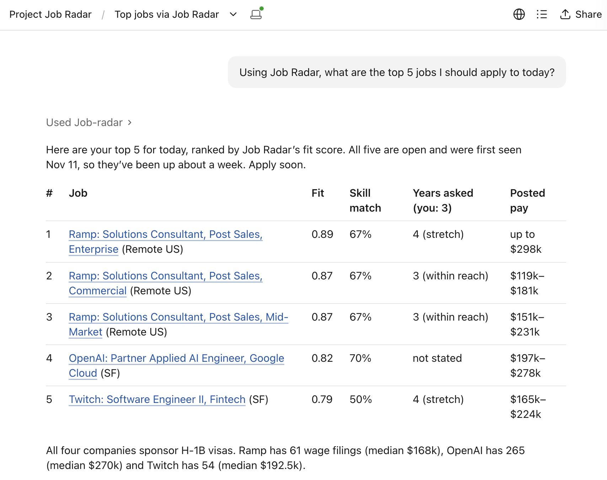

# Job Radar in Claude Desktop (MCP)

Job Radar runs as a local **MCP server**: Claude Desktop does the reasoning and calls Job
Radar's read-only tools. Questions asked this way use your Claude app plan, not the API key.

| Tool | What it does |
|---|---|
| `today_jobs` | The Today list, best fit first; filters: `reach`, `role_family` (fixed values only) |
| `run_sql` | One guarded SELECT over the five gold tables, capped at 100 rows |
| `describe_tables` | Columns and types of the gold tables |
| `search_job_text` | Search job descriptions by meaning; quotes the passage and links the job |
| `salary_check` | Posted salary vs similar jobs and the company's H-1B filed wages |
| `resume_fit` | Your resume vs one job; the resume stays on the laptop, only skill names return |

Every tool is marked read-only, every query goes through the SQL guard, and every result
is wrapped as untrusted third-party text.



## Set up

1. `pip install -e ".[mcp]"` in the `jobradar` environment.
2. Open Claude Desktop → Settings → Developer → Edit Config, and add:

```json
{
  "mcpServers": {
    "job-radar": {
      "command": "/opt/anaconda3/envs/jobradar/bin/jobradar",
      "args": ["mcp", "--dir", "/Users/<you>/Projects/job-radar"]
    }
  }
}
```

`command` is the full path from `which jobradar`; `--dir` is the repo folder, so the
server finds `.env` (Databricks connection) and `data/` (search index, resume).

3. Quit and reopen Claude Desktop. The tools appear under the tools (slider) icon.

Try: "What are my top 5 jobs today?", "Which jobs within reach mention NetSuite and Python?",
"Is the pay fair for that Figma role?", "How well does my resume fit it?"

## Troubleshooting

- Logs: `~/Library/Logs/Claude/mcp-server-job-radar.log`.
- Test outside Claude: `jobradar mcp --dir ~/Projects/job-radar` should wait silently for
  input (Ctrl+C to stop); anything printed to the screen there would break the protocol.
